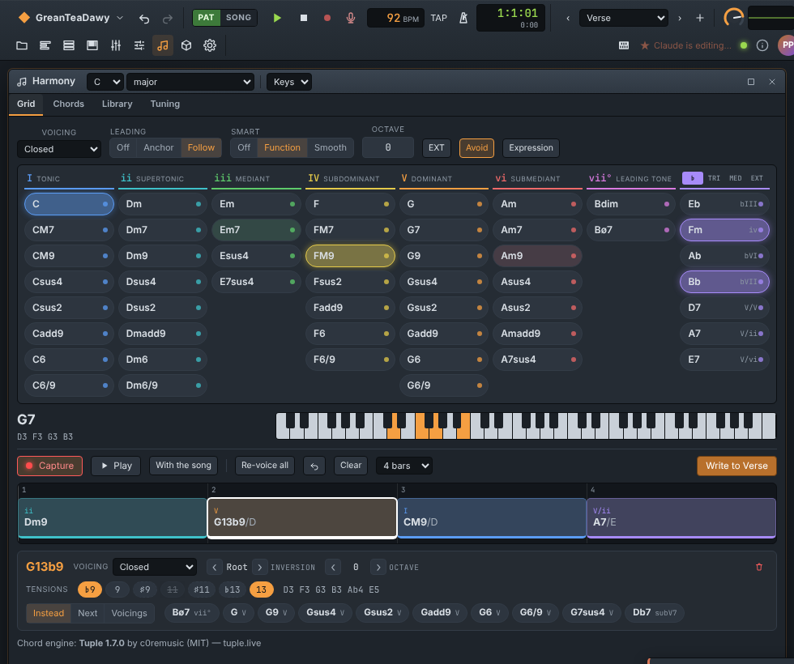

# The chord grid

Every chord of the key on one grid, the borrowed ones beside it, what could come next glowing, and a track of cards
to try a progression on — **Harmony → Grid**. Claude composes from the same grid (`chord_grid`, `add_grid_chords`),
so a progression it writes is more than four plain triads.



The harmonic engine is **[Tuple](https://github.com/c0remusic/tuple)**'s — a free, open-source Max for Live chord
device by c0remusic (MIT licence) — running here outside Ableton Live, unchanged. The layout follows Tuple's too. The
studio's part is everything around it: playing a channel of your song, the song's key and spelling, the loop on the
audio clock, writing to patterns, and the tools for Claude. Added in 0.20.0.

## The grid

Open the Harmony window (the ♪ button in the toolbar): it opens on **Grid**. The title bar holds the **key**, the
**scale** and the **channel** that plays what you click.

- **Seven columns, one per degree** (I … VII), each in its own colour, with every chord the scale has there: the
  triad, the seventh, the ninth, sus4, sus2, add9, 6, 6/9, 7sus4, and the altered dominants where the scale gives
  them. A chord that would leave the scale is not shown — nothing on the grid is "wrong".
- **The eighth column is borrowed chords**, on four pages (the pills in its header):
  **♭ Borrowed** — modal interchange and secondary dominants (in C major: E♭, Fm, A♭, B♭, D7, A7, E7);
  **TRI Tritone** — tritone substitutes of the chords you are most likely to go to next (each shows where it leads);
  **MED Mediants** — chromatic mediants (major and minor keys only);
  **EXT Ext** — richer forms of the degree you just played: 13ths, 11ths, added notes.
- **Click a chord to hear it**; hold to sustain. The name, its degree and its notes show under the grid, on a
  keyboard; hovering a chord outlines the notes it would play.
- **Smart** lights up where the progression could go after the chord you just played — brighter is stronger —
  *by function* (where harmony expects to go) or *smooth* (the same candidates, the easiest to reach by voice leading
  first). Hover a lit chord for what it does: *comes to rest*, *sets up the dominant*, *builds tension*, *a colour from
  outside the key*.
- **Voicing** spreads the notes: Default, Closed, Clear, Open, Section (drop 2), Chord Melody (drop 3), Two Hands,
  Rootless (no root — the bass has it — and the ninth in its place).
- **Leading** is voice leading: *Off* (each chord on its own), *Anchor* (every chord around the same register: the
  same chord always sounds the same — stable loops), *Follow* (each chord moves as little as it can from the one
  before, common tones kept).
- **EXT** enriches the Borrowed column (E♭ becomes E♭add9 or E♭M9, tritone substitutes get their ♯11); **Avoid**
  keeps tensions that clash with a chord out of the offer; **Octave** moves the register.
- **Expression** opens strum (milliseconds between the notes: positive = low to high; above ~60 ms it is an
  arpeggio), a velocity ramp along the strum, its curve, humanize, and a velocity range.

Keyboard: arrows move between chords, **Enter** or **Space** plays while held, **Shift+Enter** puts the chord on the
track.

## The track

Below the grid is a loop of 4 to 32 bars holding **cards**, one per chord.

- **Capture** on: every chord you play lands on the track, after the selected card. Off: **double-click** a chord,
  or **drag** it to the bar you want.
- **A card**: click to hear and select it; drag to move (it lands before or after the card it is dropped on), drag
  its right edge to make it longer or shorter — it takes the room of the cards it grows over. Arrows move a focused
  card, Alt+arrows change its length, Delete removes it. Lengths go down to an eighth of a bar.
- **The selected card** shows its own controls: **voicing**, **inversion** (a card you turn over by hand stays where
  you put it — *Free* gives it back to voice leading), **octave**, and its **tensions** ♭9 9 ♯9 11 ♯11 ♭13 13 —
  outlined ones are already in the chord, struck-through ones are avoid notes (hover for why), dashed ones are outside
  the scale. G7 with 13 and ♭9 becomes G13♭9.
- **Instead / Next / Voicings** under it: chords that could stand in for the card (same function, the same degree in
  another form, a tritone substitute), chords that could follow it (best first), and the same chord in every voicing.
  Click to hear, double-click (or Shift+Enter) to use.
- **Re-voice all** leads the whole track again as one chain; **Undo** steps back through the track's own history;
  **Play** loops it at the song's tempo on the selected channel — with **With the song** on, the song's own playback
  starts at the same instant, so you hear the chords against the beat.
- **Write to &lt;pattern&gt;** turns the track into notes for the channel in the selected pattern (one undo step):
  it replaces what the channel had under the track and grows the pattern if needed. Strum and humanize are written
  as you hear them, and writing twice gives the same notes.

The grid **follows the song**: change the key or the scale and its chords change, and the cards move with it (a card
whose chord the new scale does not have keeps playing, with a dashed outline; tensions the new chord cannot take are
dropped). Each project's grid — cards and settings — is kept in this browser; the notes you write are in the project.

### Scales

The grid knows 30 scales: major, minor, the modes, harmonic and melodic minor and all their modes, harmonic major and
its modes, and both pentatonics. With any other scale of the studio (blues, whole-tone, the ragas…) it shows the
closest of these and says so. In plain **minor** the fifth degree is a minor chord, as the scale has it; the major V
is in the Borrowed column, and V7 with it in **harmonic minor**.

## For Claude

| Tool | What it does |
|---|---|
| `chord_grid` | The palette of the key: every chord per degree, the borrowed column, chromatic mediants, a tritone substitute for each dominant, the Ext forms of each degree. `after: ["Dm9", "G7"]` adds where the progression could go, strongest first; `chord: "G7"` explains one chord — its notes in each voicing, the tensions it takes and avoids (with the reason), substitutes, what follows |
| `add_grid_chords` | Writes a progression voiced by the engine: `voicing`, `leading`, per-chord `tensions` / `bars` / `voicing` / `inversion` / `octave`, `strum`, `humanize`, `velocity`, `startBar`. Works in `batch` and with `dryRun` |

```text
add_grid_chords pattern="Verse" channel="Keys" voicing="drop2" strum=20 humanize=15
  chords=["Dm9", { chord: "G7", tensions: ["b9", "13"] }, { chord: "CM9", bars: 2 }]
→ Wrote Dm9 – G13b9 – CM9 (ii – V – I) to "Keys" in "Verse", bars 1–4 …
```

Chord names are the grid's (`CM7`, `Bø7`, `C6/9`); the usual spellings are understood (`Cmaj7`, `Bm7b5`, `C69`).
A chord no page offers is spelled from its name and voiced all the same — `E7` in A minor, `Cm7` in C major. What the
grid refuses says why and changes nothing: an unknown name, a tension that is an avoid note (`avoidNotes: false`
allows it), an altered ninth on a rootless voicing. `add_chords` remains for slash chords, power chords, arpeggios
and rhythm patterns.

The guide Claude reads tells it to start harmony here: sevenths or richer on most chords, one colour from outside the
key per phrase, tensions the scale has first, a top voice that moves by step — and plain triads where the style is
made of them.

## What to know

- **Six notes at most** per chord, as in Tuple (it has six MIDI outputs).
- **The Rootless voicing plays the natural ninth where the root was.** An altered ninth (♭9, ♯9) added on top sounds
  with it; the card says so, and `add_grid_chords` refuses the combination.
- **A bar is a bar of your song** (three beats in 3/4). Tuple itself always counts four beats.
- **Changing the scale drops tensions** a card's new chord cannot take; changing back does not restore them (Undo in
  the track does).
- The grid's cards live in the browser, not in the project: another device starts with an empty track, and Claude
  does not see your cards — it writes notes.
- Nothing here has been judged by ear in this repository's tests: they check notes, not taste.

## For developers

`packages/chord-grid` holds the engine and its adapter (see its README): `src/tuple-engine.js` is **generated** by
`scripts/vendor-tuple.mjs` from a Tuple checkout and never edited; `src/host.js` stands in for Max (outlets as events,
`Task` on a virtual clock — no timers —, a seeded `Math.random`); `src/index.js` is `createChordGrid()`. In the
client, `lib/chordGrid.js` is the per-project session (player, loop, storage, writing) and
`components/ChordGrid.jsx` the tab; the engine is a separate chunk loaded when the tab first opens. On the server,
`mcp/tools/chordgrid.js` builds a fresh grid per call.

To move to a newer Tuple: clone it, run `node packages/chord-grid/scripts/vendor-tuple.mjs <checkout>`, then
`npm test -w packages/chord-grid` and the e2e spec `e2e/workflow-chordgrid.spec.js` — and listen, because a new
version may voice chords differently.

Tuple's licence (MIT, © 2026 c0remusic) is in `packages/chord-grid/LICENSE-tuple.txt` and at the top of the generated
file. Its Smart Chords ordering was tuned by its authors against the Rolling Stone 200 corpus (de Clercq & Temperley,
CC BY 4.0) and the McGill Billboard corpus (Burgoyne, Wild & Fujinaga, CC0); neither corpus is shipped.
