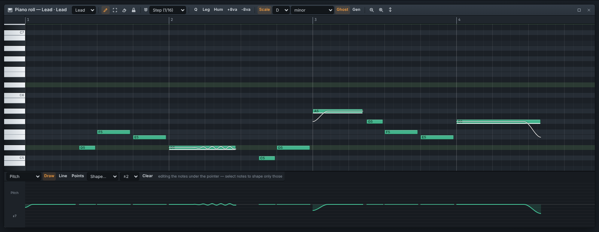

# Per-note expression

Every note can carry a performance of its own: a **pitch** curve, a **pressure** curve, a **slide** (timbre) curve
and a **release velocity** — the dimensions of an MPE controller, stored in the note. You do not need an MPE keyboard:
draw the curves in the piano roll, have Claude write them, or play them in from any MIDI controller.

[](screenshots/expression.png)

## The model

```json
{
  "id": "n_123", "key": 64, "start": 384, "length": 192, "velocity": 0.84, "releaseVelocity": 0.42,
  "expression": {
    "pitch":    [{ "t": 0, "v": 0 }, { "t": 0.45, "v": 0.35 }, { "t": 1, "v": 0 }],
    "pressure": [{ "t": 0, "v": 0.1, "c": "smooth" }, { "t": 0.3, "v": 0.85 }, { "t": 1, "v": 0.2 }],
    "timbre":   [{ "t": 0, "v": 0.15 }, { "t": 1, "v": 0.9 }]
  }
}
```

- `t` is **normalized note time** (0 = start, 1 = end): moving, resizing, duplicating or quantizing a note keeps its
  performance.
- `v` is semitones for pitch (−48…48) and 0…1 for pressure and timbre. A dimension without a curve rests at 0.
- `c` says how the curve travels to the **next** point: absent = straight line, `"smooth"` = eased, `"hold"` =
  stay, then jump. Before the first point a curve holds its first value; after the last, its last (the release hears it).
- At most 64 points per curve (freehand strokes are simplified to fit).
- `releaseVelocity` (0…1, 0.5 neutral) is how the note is let go.

Code: `packages/core/src/expression.js` (`sanitizeCurve`, `curveValueAt`, `flattenCurve`, `simplifyCurve`,
`transformCurve`, `makeCurve`). Projects without expression are unchanged; the field is optional and the project
format version stays 1.

### Editing is an op

`notes/expression` patches the performance of existing notes: each curve named is replaced (`null` removes it), the
others are kept — a pitch edit and a pressure edit of the same note never overwrite each other. Like every op it is
undoable, deterministic and synced live.

```js
{ type: 'notes/expression', patternId, channelId, notes: [{ id, expression: { pitch: [...] }, releaseVelocity: 0.8 }] }
```

## What hears it

| Dimension | GGS Synth | Every other instrument |
|-----------|-----------|------------------------|
| Pitch | each voice's own pitch input | follows through the detune of the voice's oscillators and sample players |
| Pressure, slide | modulation sources `pressure` and `timbre`, routed in the patch's matrix | not audible |
| Release velocity | scales the release time (*Rel. velocity*) and is the `releaseVel` source | — |

Bending one note of a chord therefore works on a piano or a sampler too; pressure and slide need a
[GGS Synth](ggs-synth.md) patch that routes them (every preset does). `evaluate_composition` flags curves that
nothing responds to.

Playback schedules a curve as **AudioParam automation** — straight segments become exact linear ramps on the voice's
`pitch` / `pressure` / `timbre` inputs — so it is sample-accurate and identical in realtime and offline renders.
A note cut short by a clip end still plays its curves at their own pace.

## In the piano roll

The lane under the notes has a selector: **Velocity · Release vel. · Pitch · Pressure · Slide**.

- Curve lanes draw each note's curve over the note's own span. **Select a note to shape only that note**; with
  nothing selected an edit goes to the notes under the pointer (and a stroke that runs on shapes the next notes too —
  a swell across a phrase).
- Tools: **Draw** (freehand), **Line**, **Points** (click to add, drag to move, right-click to delete, Alt-click to
  cycle straight → eased → hold). **Shape…** applies a ready-made gesture: bend, scoop, fall, vibrato, swell, ramp,
  pulse. **Clear** removes the lane's data from the selection.
- The pitch lane's range (±2 … ±48 semitones) widens by itself when a curve needs it.
- Pitch curves are also drawn **over the notes in the grid**, one row per semitone, so you see where a bend lands.
- After an edit of a single note, that note is played back with its new performance.

## Playing it in (MIDI / MPE)

Connect a controller (toolbar → MIDI). `packages/core/src/mpe.js` decodes:

| Message | Becomes |
|---------|---------|
| Pitch bend (per channel) | the pitch of the notes on that channel |
| Channel pressure, poly pressure | pressure |
| CC 74 (and CC 1, the mod wheel) | slide |
| Note-off velocity | release velocity |

On an MPE controller every note has its own channel, so each finger moves its own note. Channel 1 is the master
channel: what it sends applies to every sounding note. Bend ranges follow RPN 0; otherwise ±48 semitones on member
channels and ±2 on channel 1 — so an ordinary keyboard works too (wheel, aftertouch and mod wheel reach all its notes).

With **Record** on while playing, what the controller did during each note is recorded as that note's curves.

## MIDI files

Exporting a project writes a channel whose notes have curves as an **MPE track**: one note per member channel with
its pitch bend (±48), channel pressure and CC 74, note-off velocity for the release. Importing reads the same back
into curves (and gives a track played with pressure or slide a GGS Synth). Channels without curves are written
exactly as before.

## For Claude (MCP)

| Tool | Does |
|------|------|
| `set_note_expression` | Write curves as shapes (`bend`, `scoop`, `fall`, `vibrato`, `swell`, `ramp`, `pulse`) or points, per note / pitch / step range; release velocity |
| `get_note_expression` | Read curves back as structured points |
| `transform_note_expression` | Scale, offset, invert, reverse, smooth, re-time |
| `copy_note_expression` | Copy one note's performance to others |
| `add_notes` | Accepts `expression` and `releaseVelocity` inline |
| `evaluate_composition` | Flags pressure/slide curves nothing listens to (among other things) |
