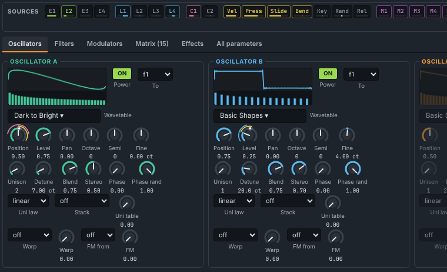
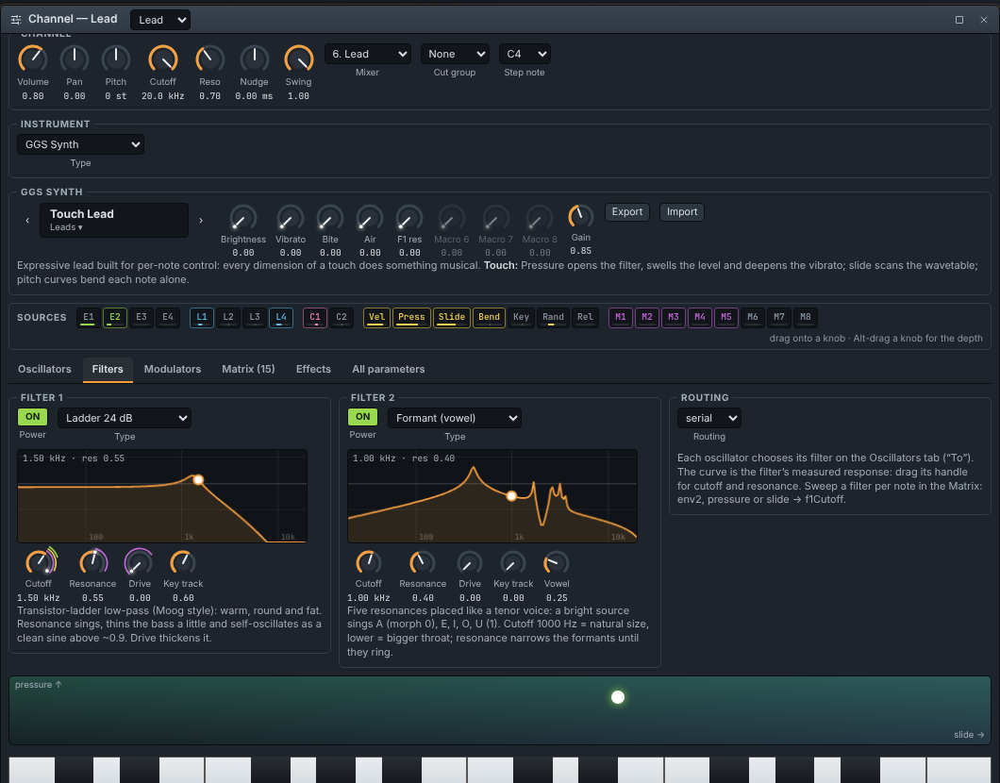
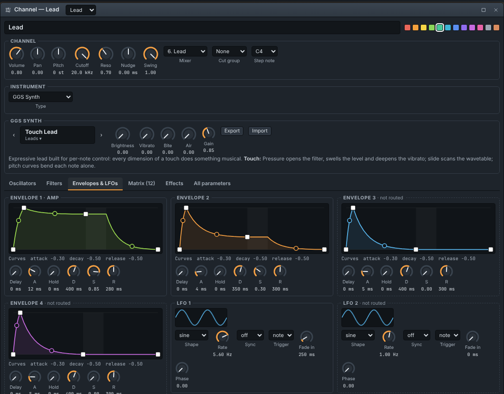
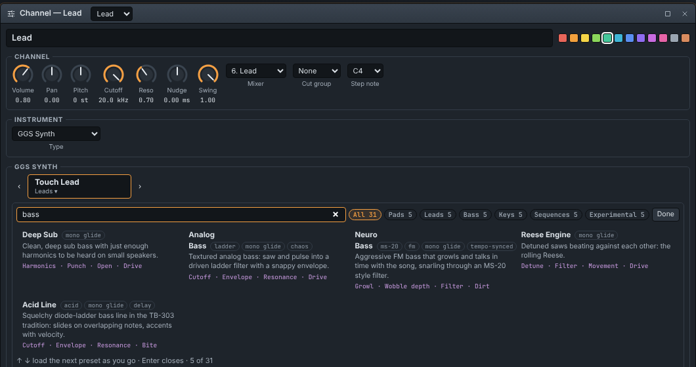
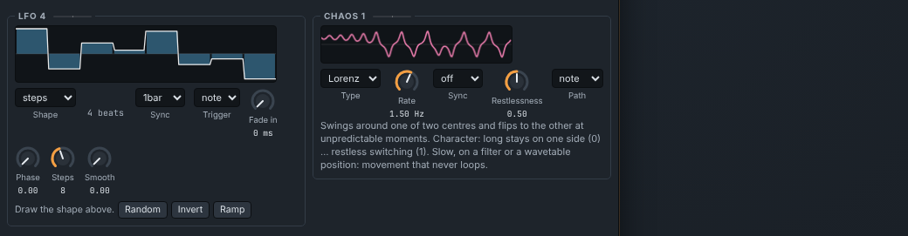

# GGS Synth

The GGS Synth is the studio's sound-design instrument: a wavetable / FM hybrid with a modulation matrix, built so
that **every note can be played on its own** — its own pitch bend, pressure and slide. It is an original engine
(`packages/synth-dsp`, plain JavaScript, MIT) that runs in an AudioWorklet in the browser and in Node on the server.

[](screenshots/ggs-synth.png)

Add one from the Browser (**Synths → GGS Synth**), or ask Claude: *"create a warm evolving pad with the GGS Synth"*.

## Signal path

```
oscillators A · B · C ─┐                       ┌─ filter 1 ─┐ serial or
sub oscillator ────────┼─ each routed to ──────┤            ├─ parallel ─→ amp (envelope 1 × velocity) ─→ pan
noise ─────────────────┘  f1 / f2 / both /     └─ filter 2 ─┘                       │
                          direct                                    per note ───────┘
                                                                    per channel ↓
                                                    drive → chorus → delay → reverb → gain → channel strip → mixer
```

| Section | What it has |
|---------|-------------|
| **Oscillators A, B, C** | 46 wavetables scanned by *Position*; level, pan, octave/semi/fine; **unison** 1–8 with detune, blend and stereo spread; start phase and phase randomness; **warp** (bend, pulse-width, sync, mirror, fold, quantize); **FM** — phase modulation from another oscillator, the sub, noise or itself (feedback) |
| **Sub / Noise** | Sine, triangle, saw or square 0–3 octaves down; white, pink or brown noise with a colour control. Each routed like an oscillator |
| **Filters 1 & 2** | 21 models (see [Filters](#filters)): clean low-, high- and band-pass at 12 or 24 dB/octave, notch, peak, all-pass and a morphing shape; analog-style **ladder**, **acid** and **MS-20**; **formant**, **phaser** and two tuned **combs**. Cutoff, resonance, drive, key tracking and a *Morph* control whose job depends on the model |
| **Envelopes 1–4** | Delay, attack, hold, decay, sustain, release, and a curve for each slope (attack, decay, release). Envelope 1 is the amp envelope |
| **LFOs 1–4** | Sine, triangle, saw, ramp, square, random steps, random glide, or **a shape you draw** (up to 16 steps, hard or glided); rate in Hz or tempo-synced (1/32 … 8 bars); per note or free-running; fade-in; phase |
| **Chaos 1–2** | Lorenz, Rössler, drift or a Turing-machine pattern: movement that never quite repeats (see [Chaos](#chaos)) |
| **Macros 1–8** | Eight knobs a patch assigns in the matrix. Presets name and route the first four; 5–8 are free. All can be automated over the song |
| **Matrix** | 64 routes: source → target × amount, optionally × a second source ("via") |
| **Effects** | Drive (soft, hard, tube, fold — oversampled), chorus, tempo-synced ping-pong delay, reverb, output gain |
| **Voice** | Polyphony 1–32, mono, legato, glide, velocity and release-velocity sensitivity, quality |

### Modulation

Sources: `env1`–`env4`, `lfo1`–`lfo4`, `chaos1`–`chaos2`, `velocity`, **`pressure`**, **`timbre`** (slide), **`bend`**
(the note's pitch curve), `key`, `random` (one value per note), `releaseVel`, `macro1`–`macro8`.

Targets: `pitch`, `pitchFine`, `level`, `pan`; per oscillator `oscAPitch`, `oscAPos`, `oscALevel`, `oscAPan`,
`oscAWarpAmt`, `oscAFm`, `oscADetune` (and B, C); `subLevel`, `noiseLevel`; `f1Cutoff`, `f1Res`, `f1Drive`, `f1Morph` (and f2);
`lfo1Rate`–`lfo4Rate`.

**An amount of 1 moves the target across its whole range**: `f1Cutoff` 0.3 = 3 octaves, `oscAPos` 0.5 = half the
table, `pitch` 0.5 = 12 semitones, `pitchFine` 0.3 = 0.3 semitones. A route with `via: pressure` is scaled by the
note's pressure — e.g. `lfo1 → pitchFine 0.3 via pressure` is a vibrato that deepens as a note is pressed.

Everything except the macros and "free" LFOs is **per note**: pressure on one note changes that note's filter and
nobody else's. See [expression-engine.md](expression-engine.md).

The Matrix tab and every tool reply spell each route out in the units of its target, from where the target's knob
stands: *"Filter 1 cutoff 850 Hz → 4.49 kHz as pressure goes 0 → 1"*, *"Pitch −30 ct ↔ +30 ct as LFO 1 swings
−1 ↔ 1, depth scaled by pressure"* (`describeRoute` in `packages/synth-dsp/src/patch.js`).

[](screenshots/ggs-matrix.png)

### Chaos

Two generators of modulation that never quite repeats, ported from the GGS Composer modulators. *Rate* is in Hz or
a tempo division; *Character* means something different for each:

| Type | What it does | Rate | Character |
|------|--------------|------|-----------|
| `lorenz` | Swings around one of two centres and flips to the other at unpredictable moments | swings per second | long stays on one side … restless switching |
| `rossler` | A wobbling loop that now and then lurches — an LFO with a mind of its own | orbits per second | nearly periodic … spiky |
| `drift` | A random walk that always comes home: what an analog oscillator's pitch does | how fast it wanders | jittery … rounded |
| `turing` | A looping pattern of steps that mutates (a shift register, after the Turing Machine module) | steps per second | the chance a step is replaced: 0 locks the loop |

*Path* decides who shares a path. **note** (default): every note wanders its own way — a little `drift` on
`pitchFine` is analog voice drift. **same**: every note replays one path from its start, so a chord moves as one and
a part sounds the same every time.

A tempo-synced `turing` pattern on the path *same* is the exception: it is **locked to the song** — a step sequence.
The pattern is a function of the song position alone, so every note hears the step of that moment, the steps fall
on the grid, and bar 9 sounds like bar 9 whenever it is played: in the loop, started from the middle, or in an
export. Mutation 0 is one loop for the whole song; above 0 the pattern changes as the song goes on, the same way
every time (and every step of the loop is renewed at least once in 256 turns). "Free" LFOs follow the same clock.
With the transport stopped there is no song position: notes played by hand share a clock that starts with the
first note after a silence, so a chord still hears one pattern.

A path is fixed by its note (the seed comes from the note's time and key), so **two renders of a song are the same
audio** even with chaos everywhere. The attractors are integrated with RK4 at a fixed step in their own time and
read with cubic Hermite interpolation, so the result does not depend on the rate, the sample rate or the block size.
A chaos generator costs nothing until it is routed.

### Filters

| Model | Character | Morph |
|-------|-----------|-------|
| `lp12` `lp24` `hp12` `hp24` `bp12` `bp24` `notch` `peak` | Clean: a zero-delay-feedback state-variable filter. Exact cutoff, linear, stable under any sweep; Butterworth at zero resonance | — |
| `allpass` | Flat response, the phase turns around the cutoff: moving notches when run in parallel with the other filter | — |
| `morph` | One clean 2-pole filter whose shape slides low-pass → band-pass → high-pass with the resonant peak held level | shape |
| `ladder24` `ladder12` `ladderBp` `ladderHp` | Transistor ladder (Moog style) with a saturating input stage: warm and fat; the resonance sings, thins the bass a little and **self-oscillates as a sine exactly on the cutoff** above about 0.9 | — |
| `acid` | Diode ladder (TB-303 style): a soft slope that is darker than its cutoff suggests and a rubbery, squelching resonance. Drive sits after the filter, so the sweep itself screams | — |
| `ms20Lp` `ms20Hp` | Sallen-Key (Korg-35 style) with the resonance clipped inside the loop: it screams instead of whistling, keeps its bass at any resonance and ducks under a loud input | — |
| `formant` | Five resonances placed like a tenor's vowels. Cutoff moves the size of the throat (1000 Hz = natural), resonance narrows the formants | vowel A · E · I · O · U |
| `phaser` | 2–12 all-pass stages mixed with the dry signal, per note; resonance sharpens the peaks between the notches | stages |
| `comb` `combNeg` | A tuned feedback delay: cutoff is its pitch (key track 1 tunes it to the note), resonance its ring time. With a noise burst it is a plucked string; `combNeg` gives the hollow, odd-harmonic set an octave down | damping |

The analog-style models are ports of the GGS Composer filter crate: the delay-free loops are solved per sample
(Zavalishin's topology-preserving forms, one Halley step around a rational `tanh`), not approximated with a unit
delay — which is why the self-oscillation is in tune: within 0.1 cent for the ladder at the doubled rate these
models run at by default, within a cent up to 12 kHz without oversampling.
They make harmonics of their own, so quality `auto` renders them at 2×.

The curve in the editor is **measured**: `filterResponse` feeds the real filter an impulse and transforms what comes
out, so it is right for every model and shows what drive and resonance compensation actually do.

### Wavetables

`basic` (sine → triangle → saw → square → pulse), `tilt`, `pwm`, `resonant`, `formant` (vowels), `glass`, `fmbell`,
`fmgrowl`, `drawbar`, `sync`, `fold`, `metal`, `airy`, `ladder` (one overtone per frame), `primes`, `octaves`, `comb`,
`staircase`, `tine`, `bowed`, `reed`, `dust`, `hollow`, `supersine` — and, ported from the GGS Composer factory set:
`oddeven`, `lofi`, `phasedist` (CZ-style), `cheby`, `pluck`, `sawstack`, `hiss`, `drift`, `aurora`, `brass`, `reese`,
`acid`, `overdrive`, `vowelbass`, `crystal`, `bitlogic`, `talkbox`, `whisper`, `ringmod`, `trifold`, `vosim`,
`darkmatter`. The wavetable picker in the editor shows all 46 with their waves; `describe_synth` topic "wavetables"
describes each.

Tables are stored as harmonic series, not samples. The engine builds band-limited copies on demand — three per
octave — and a note only ever reads a copy whose highest harmonic is below Nyquist, so the oscillators themselves
cannot alias. Frames of a table share a phase convention, so scanning between them cross-fades without cancelling.

### Presets

30 presets in six families, each with four named macros and a stated response to pressure and slide:

| Family | Presets |
|--------|---------|
| Pads | Velvet Pad, Glass Horizon, Cinema Atmos, Choir of Air, Solar Drift |
| Leads | Touch Lead, Crystal Lead, Mono Titan, Sync Razor, Overtone Flute |
| Bass | Deep Sub, Analog Bass, Neuro Bass, Reese Engine, Acid Line |
| Keys | Glass Keys, Tine Electric, Pluck Garden, Dream EP, Hollow Mallet |
| Sequences | Arp Prism, Pulse Runner, Poly Rhythm, Bell Sequence, Chip Stepper |
| Experimental | Spectral Motion, Metal Resonator, Nova Stack, Vowel Morph, Fold Drone |

Presets built on the analog-style and special filters: *Acid Line* (`acid`), *Analog Bass* and *Mono Titan*
(`ladder24`), *Neuro Bass* (`ms20Lp`), *Vowel Morph* (`formant`), *Solar Drift* (a `phaser` after its low-pass),
*Pluck Garden* and *Metal Resonator* (`comb`).

Presets are **levelled by measurement** (`node packages/synth-dsp/scripts/level-presets.mjs`): one note at velocity
0.8 peaks at −18 LUFS (loudest 400 ms), unless its sample peak would pass −9 dBFS — sharp attacks are capped by
their peak instead. Swapping presets does not upset a mix. The **Expressive synths** project template (File → New
from template) is a 24-bar piece on six of them with a full performance written into the notes.

## The editor

Select a GGS channel and open **Channel settings** (F8).

- **Presets**: the name in the header opens a browser — categories, and a search that looks at names, descriptions,
  macro names and tags worked out from each patch (`acid`, `fm`, `unison`, `mono glide`, `tempo-synced` …). ↑ ↓ load
  the next preset as they move, so you can audition with one hand on a keyboard; ‹ › step without opening it.
- **Oscillators**: waveform and harmonic spectrum of each oscillator at its position. The wavetable name opens a grid
  of all 46 tables drawn at the start, middle and end of each; search it, or walk it with the arrow keys.
- **Filters**: the measured response of each filter. **Drag the handle**: left/right is the cutoff, up/down the
  resonance. The menu is grouped (clean, analog, special) and a line under the knobs says what the chosen model is for.
- **Modulators**: envelopes are shaped by hand — square nodes for the delay, the attack, the hold, decay +
  sustain and the release; **round handles bend a slope** (press one twice to reset it; the numbers under the graph
  edit the same curves). Attack and hold share a node while the hold is zero: drag it right to add a hold. An LFO set
  to *steps* shows bars you draw with the pointer (and Random / Invert / Ramp). The two chaos generators show twelve
  cycles of their path. Sections that are not routed yet are dashed; a thin meter next to each title follows the
  source while a note sounds.
- **Matrix**: every route with a sentence underneath saying what it does in real units; a filter box (a source, a
  target, any word), a colour per family of sources, a live meter per route. 64 slots.

**Modulating from the knobs.** Under the header sits the **source bar**: every source as a chip with a small meter
that shows what it is doing right now.
- **Drag a chip onto a knob** to modulate it (or right-click the knob → *Modulate with*). The knob gets a **ring** —
  one thin arc per route, coloured by its source's family (green envelopes, blue LFOs, pink chaos, yellow the note,
  purple macros) — showing how far that route can take it from where the knob stands.
- **Alt-drag the knob** to set the depth of the route (the one you added or chose last; the menu says which).
- While a note sounds, a **bright dot** on the knob shows where the control really is: the sum of everything the
  matrix is doing to it, reported by the voice about thirty times a second.
- Right-click a modulated knob to invert or remove a route, or to see it in the matrix; click a chip to see all
  the routes of that source.

[](screenshots/ggs-rings.png)

The header has **eight macro knobs**. A preset names its macros; a macro you route yourself is named after what it
moves (“F1 cutoff”, “F1 cutoff +2”), and the ones a patch does not use are dimmed. Right-click a macro →
*Automate in the playlist* makes an automation clip for it (the playlist's *Create automation clip* menu lists the
macros of every GGS channel too); the dot on the knob follows the automation.
- **Effects**, and **All parameters**: every parameter of the patch in one searchable table — value, range and what it
  does — with a *Changed* filter that shows what makes this patch different from the init patch. The same
  descriptions are the tooltips of every control.

The header also has the eight macros with their names, gain, and **Export / Import** of a patch as a `.json` document.

| | |
|---|---|
| [](screenshots/ggs-filters.png) **Filters** — the measured response; drag the handle | [](screenshots/ggs-envelopes.png) **Envelopes** — nodes for the times, round handles for the curves |
| [](screenshots/ggs-presets.png) **Presets** — search, categories, tags | [](screenshots/ggs-wavetables.png) **Wavetables** — all 46, drawn |

[](screenshots/ggs-chaos.png)

The **touch pad** at the bottom plays the patch the way an MPE controller would: hold it to sound the step note,
move up for pressure and right for slide.

A knob turned while notes sound changes them immediately. Changes to what a voice is made of — switching an
oscillator, picking another wavetable or filter model, changing the routing — are **click-free**: that part of the
voice fades out for 4 ms, is swapped while silent and fades back in. A drag on a graph is one undo step. Everything
is undoable and syncs live to other tabs.

## Patch documents

Inside a project a patch is the instrument's flat `params` (like every instrument). For files and agents the same
patch reads as a document (`paramsToPatch` / `patchToParams` in `packages/synth-dsp/src/patch.js`):

```json
{
  "format": "ggs-synth-patch", "version": 1, "name": "Glass Horizon",
  "oscillators": [{ "id": "A", "table": "glass", "position": 0.35, "unison": 3, "detune": 7 }],
  "filters": [{ "id": 1, "type": "lp12", "cutoff": 5200 }],
  "envelopes": [{ "id": 1, "attack": 1.2, "release": 3 }],
  "modulation": [{ "source": "pressure", "target": "oscAPos", "amount": 0.42 }],
  "voice": { "polyphony": 16 },
  "effects": { "reverb": { "mix": 0.5, "size": 0.85 } }
}
```

A document may be partial; an oscillator or filter it describes is switched on. A `modulation` list replaces the
whole matrix. Envelopes take `delay`, `attack`, `hold`, `decay`, `sustain`, `release`, `attackCurve`, `decayCurve`,
`releaseCurve`; filters also take `morph`. Documents and projects saved by 0.8.0, whose envelopes had one `curve`,
load unchanged: the single curve is converted to the three stage curves that draw exactly the same envelope.

## For Claude (MCP)

| Tool | Does |
|------|------|
| `describe_synth` | The reference: overview, every field with its range and what it does, the filter models, wavetables, modulation sources/targets, presets |
| `create_synth_patch` | A GGS channel from a preset and/or a patch document |
| `get_synth_patch` / `update_synth_patch` | Read a patch (summary or document) / apply a document |
| `set_synth_oscillator`, `set_synth_filter`, `set_synth_envelope`, `set_synth_lfo`, `set_synth_chaos`, `set_synth_modulation`, `set_synth_effect` | Edit one section, strictly validated. `set_synth_filter` replies with the measured response of the setting; every reply lists the modulation routes in real units |
| `analyze_synth_patch` | Render a note or chord **on the server** (no browser) and measure pitch, loudness, spectrum, envelope — optionally with pressure / slide / pitch curves and macro values |

Macros are automated with `add_automation` (target `channel`, param `macro1`…`macro8`). `set_synth_lfo` takes a
drawn shape as `steps: [1, 0, 0.5, …]`; `set_synth_chaos` sketches the path it sets in its reply.

## Engineering notes

- **One AudioWorklet processor per note** (`ggs-voice`). The patch arrives with the note (`processorOptions`); gate,
  kill, pitch, pressure, timbre and the eight macros are AudioParams. Nothing depends on message timing, so realtime
  playback and offline renders share one deterministic path; two renders of a song are the same audio (in Node to the
  bit; in a browser to about −110 dB, because its mixer does not add up in the same order twice — see
  [benchmarks](audio-benchmarks.md)).
- A per-channel `ggs-fx` processor runs the effects after the voices are summed, and eight constant sources feed
  every voice's macro inputs (that is what automation moves).
- **The song clock.** A note is told where the song stands on its first frame (`beat` in `processorOptions`: the
  transport's position for the notes it schedules, `engine.beatAt` for notes played by hand) and counts on from
  there in frames. "Free" LFOs and song-locked Turing patterns are functions of that position — not of the audio
  context's clock, which starts at a different moment on every Play and in every render. The Turing tape can be
  entered at any step (`Chaos.at`): the bit a step brings is read off the step's number, so a note at bar 200 works
  out the register in microseconds instead of running 3200 steps.
- Modulation is evaluated every 16 samples and every audible control is ramped across the block: no zipper noise.
- **Oversampling is selective** (quality `auto`): a patch that makes new harmonics after the oscillators — FM,
  warp, filter drive, the ladder / acid / MS-20 filters, the combs — runs at 2× with a polyphase half-band decimator; a plain patch, which cannot alias,
  runs at 1×. `high` forces 2×, `eco` never oversamples.
- Random parts of a note (unison phases, noise, random LFOs) are seeded from the note's time and key: renders repeat.
- A channel's wavetables are built by its effects processor when the channel appears or its patch changes — never
  on a note's first block, where the tens of milliseconds it takes would be a dropout.
- The effects rest by **level**, not by a timer: processing stops once nothing has come in and nothing audible has
  come out for longer than one echo, so a long feedback delay is never cut off.
- **A voice takes its memory in one piece** (`Arena` in `util.js`): a typed array over 64 bytes costs a separate
  off-heap allocation of about 2 µs, and a voice needs seventeen — one buffer and seventeen views cost a tenth.
  Starting a note takes 20–30 µs.
- **No function call with numbers per sample**: a call the engine decides not to inline boxes each number it is
  given. The loop solvers of the analog filters are therefore written out inside their loops (measured: 160 garbage
  collections per 30 s of audio before, none after).
- **What the editor shows live comes from the voices**: while the editor is open on a channel its `ggs-voice`
  processors post their modulation sources and targets about thirty times a second; the newest note wins. Nothing in
  the audio depends on those messages, and offline renders never send them.
- **Structural edits wait for a fade** (`SWAP_KEYS` in `voice.js`): each oscillator is its own unit, everything on
  the buses (filter models, routing, sub and noise) another. `setParams` applies knob moves at once and holds the
  structural part back until its unit's gate has closed. An oscillator that is another one's FM source fades its
  modulator signal the same way.
- Filters live in `packages/synth-dsp/src/filters.js` (`VoiceFilter`): coefficients are computed per control block and
  ramped per sample; the nine original clean types run the same code as before.
- Measured quality and CPU numbers: [audio-benchmarks.md](audio-benchmarks.md).

To change the engine see `.claude/skills/ggs-synth/SKILL.md`.
