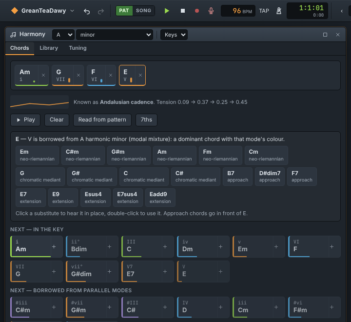
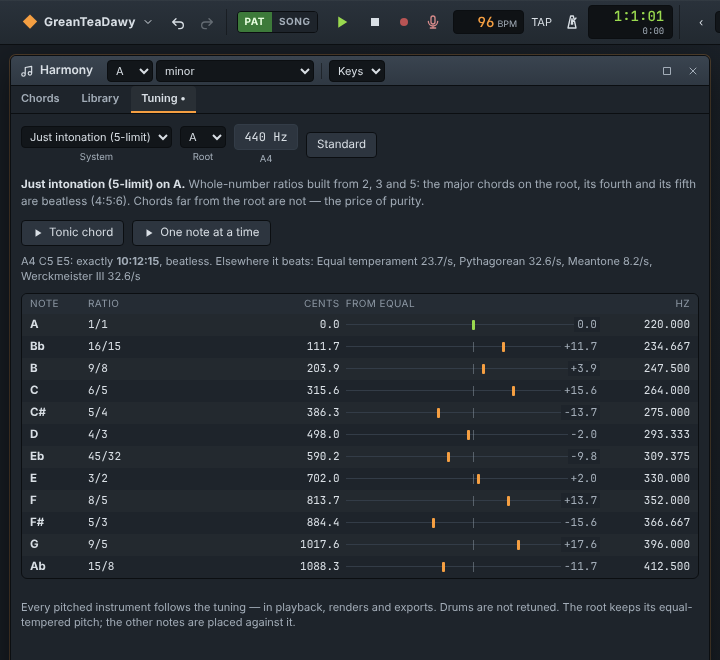

# Harmony and tuning

What the studio knows about chords, keys and tuning — in the **Harmony** window, in the piano roll, and through the
MCP tools Claude uses. Added in 0.12.0, from the music-theory part of GGS Composer (the author's earlier Rust project),
rewritten in JavaScript for this engine.

## The Harmony window

Open it with the ♪ button in the toolbar (or **Chords** in the piano roll). Its title bar holds the **key**, the
**scale** (57 of them, grouped by family — hover the picker to read what a scale sounds like) and the **channel**
that plays what you click and receives what you write.

### Chords

- **Pads** show the chords that could come next, ranked. *In the key* are the key's own chords; *Borrowed from
  parallel modes* are colours from the same tonic's other modes (the ♭VI and ♭VII of a major key, the major IV of a
  dorian-flavoured minor…); *Chromatic* holds secondary dominants, the tritone substitute, the passing diminished
  chord and chromatic mediants. Click a pad to **hear** the chord — voiced next to what you already have, the way it
  would sound in the progression — and **+** (or double-click) to **add** it.
- The **colour** of a pad or chip is what the chord does: green = tonic (rest), blue = subdominant (departure),
  orange = dominant (tension), pink = a dominant of another degree, violet = a colour from outside. The bar under a
  pad is how readily the progression moves there; hover for the reason in words ("the subdominant leans into the
  dominant", "continues *Andalusian cadence*").
- The **strip** at the top is your progression: each chord with its roman numeral and a bar for its tension. The line
  below draws the tension over time, and names the progression when the library knows it.
- Click a chord in the strip for **what could stand in for it**: tritone substitute, relatives, borrowed versions,
  neo-Riemannian neighbours (P, L, R and the film-score compounds), chromatic mediants, chords to put in front of it,
  and richer versions of the same chord. Click to hear one in place, double-click to use it.
- **Read from pattern** names the chords the channel plays in the selected pattern. **Write to …** puts the
  progression into it: choose how long each chord lasts, how it is voiced — *Smooth* voices the whole progression at
  once so that every voice moves as little as possible, avoiding parallel fifths and octaves — and whether it is held
  or arpeggiated. One undo takes it back.

### Library

82 progressions people actually use, each with the genres and moods it is known for. Search by words ("sad piano",
"andalusian", "ii-V"), click tags, switch between minor and major modes; every progression is shown in your key.
▶ plays one, a click loads it into the Chords tab.

### Tuning

Every pitched instrument of a project — synths, the GGS Synth, pianos and strings, samplers — plays in the project's
tuning; drums are not retuned. Playback, renders and exports all follow it.

| System | What it is |
| --- | --- |
| Equal temperament | Twelve equal semitones: the standard. With *Steps / octave* other than 12 each key is one step of that many (19, 24, 31, 53…). |
| Just intonation (5-limit) | Whole-number ratios from 2, 3 and 5. The major chords on the root, its fourth and its fifth are beatless (4:5:6); chords far from the root are not. |
| Just intonation (7-limit) | With the seventh harmonic: a low, sweet minor seventh (7/4) — a dominant seventh is 4:5:6:7. |
| Pythagorean | Stacked pure fifths: strong melodies and open fifths, wide restless thirds (81/64). |
| Meantone | Fifths narrowed so that major thirds are pure (¼ comma) or nearly so; one "wolf" fifth far from the root. |
| Werckmeister III, Kirnberger III, Vallotti, Young II | Well temperaments: every key playable, each with its own colour. |
| Harmonic series | The twelve notes taken from harmonics 16–30 of the root: everything fuses into one tone. |
| Custom | Twelve offsets in cents or twelve ratios of your own (set through `set_tuning`). |

**One rule holds for all of them: a tuning never moves its own root.** The root keeps the pitch it has in equal
temperament at the chosen A4, and every other note is placed against it — so a song in D, tuned on D, stays in tune
with anything else in D. The well temperaments start on C, as they were designed; the others on the key of the song.

The table shows, for each note: its **ratio** to the root (an exact fraction wherever the system is rational,
"≈ 6/5" where an irrational degree sits next to a simple one), **cents** above the root, how far it is **from equal
temperament**, and its **frequency in Hz** to three decimals. The line above the table says how the tonic chord
stands: "exactly 4:5:6, beatless", or how many times a second it beats — and how it would beat in the other systems.

The ratios are exact on purpose: a frequency read here can be used somewhere else — a picture, a light, another
instrument — and still be the same number. `describe_tuning` returns them as data.

**A4** sets the reference pitch (380–500 Hz; 440 is concert pitch, 432 and 415 the common others) for any system.

## In the piano roll

The scale picker lists the 57 scales by family. Roman numerals and chord symbols accept everything listed below.

## For Claude (MCP)

| Tool | What it does |
| --- | --- |
| `harmony` | `analyze` (numeral, function, origin and tension of each chord; the name of a known progression; or read the chords and check the key of a pattern), `suggest` (what could come next, with reasons, by pool), `substitute`, `negative` (negative harmony), `modulate` (paths to another key), `progressions` (search the library). Read-only. |
| `add_chords` | Now also `progression: "<library name>"`, and `voices: 3–6` to voice-lead the whole progression with the solver (`bass: "root"` or `"smooth"`). |
| `add_arpeggio` | Ten modes (up, down, updown, downup, converge, diverge, pinky, thumb, asplayed, random), rate, octaves, gate, swing, accents or a velocity pattern, seed. |
| `add_drum_groove` | Sixteen styles (four on the floor, house, techno, backbeat, half-time, breakbeat, boom bap, trap, drum & bass, 2-step, shuffle, reggaeton, bossa nova, synthwave, lo-fi, sparse cinematic) written onto the drum channels there are — missing ones are created. `variation`, `fill`, `swing`, `seed`. |
| `write_drums` | A track may be a Euclidean rhythm: `"E(5,16)"`, `"E(3,8,2)"` (rotated), `"E(3,8)x4"` (repeated). |
| `set_tuning` | System, root, A4, and what the system needs (`divisions`, `fraction`, `cents` or `ratios`). Only what is named changes. |
| `describe_tuning` | The table of a tuning with exact ratios, cents and Hz; with `chord` or `notes`, how pure that chord is (nearest ratio, cents off, beats per second) and, with `compare`, in other systems. Read-only. |
| `music_theory` | New actions: `scales` (all 57, by family, with descriptions), `chord_types` (all 65), `identify` (name the chord notes make), `euclid`. Any scale name works everywhere ("aeolian", "jazz minor", "phrygian dominant"). |

Everything that varies takes a **seed** and gives the same notes for the same seed.

### Chords and numerals

- **65 chord types**: triads, sus, sixths and 6/9, sevenths, add chords, ninths, elevenths, thirteenths, altered
  dominants (7♭9, 7♯9, 7♯11, 7♭13, 7alt…), quartal. Every common spelling is read: `Cmaj7` `CM7` `CΔ`; `Cm7` `Cmin7`
  `C-7`; `Cm7b5` `Cø`; `C7(b9)`; `C6/9`. `music_theory action="chord_types"` lists them.
- **Roman numerals**: a degree (upper case = major, lower case = minor) and any chord quality — `ii7`, `V7#9`,
  `bVII`, `vii°7`, `IVmaj7`, `i(maj7)`. `V7/V` applies a chord to another degree; `IV/1` puts it over a bass degree;
  `I64`, `V65`, `V43`, `V42` are inversions; `N6` is the Neapolitan. The degree is the key's own — in A minor `VI` is
  F — and an accidental moves it unless the key already has it (`bVII` in A minor is the same G as `VII`).

## How it decides (for developers)

All of it is plain functions in `packages/core/src`, shared by the server and the browser:

| File | Holds |
| --- | --- |
| `scales.js`, `chords.js`, `progressions.js` | The dictionaries (data only). |
| `music.js` | Notes, scales, chord parsing, roman numerals, spelling. |
| `harmony.js` | `keyContext`, `readChord`, `numeralFor` (the exact inverse of `romanToChord`: tested on every chord type × root × bass in twelve kinds of key), `functionOf`, `analyzeChord`, `chordTension`, `detectChords`, `detectKey`, `chordsFromNotes`. |
| `chordflow.js` | `suggestNext`, `substitutions`, `neoRiemannian`, `negativeHarmony`, `modulationPaths`, the library search. |
| `voicelead.js` | `voiceLead`: every admissible voicing of every chord, and the path of least movement through them (Viterbi). |
| `patterns.js`, `rng.js` | `arpeggiate`, `euclid`, `drumPattern`; a seeded random source (generators never call `Math.random`). |
| `tuning.js` | `normalizeTuning`, `tuningDegrees`, `tunedFrequency`, `tuningCents`, `tuningTable`, `chordPurity`. |

- **Suggestions** score a candidate as `(0.50·flow + 0.15·voice + 0.10·common + 0.25·root) × tier × repeat`: *flow*
  is how readily the last chord's degree (or function) moves there, from two 7×7 tables for major and minor keys;
  *voice* how little the notes move; *common* the notes shared; *root* the strength of the root movement; *tier* 1 in
  the key, 0.9 borrowed, 0.82 chromatic; *repeat* 0.25 for the chord just played. A dominant seventh resolving a fifth
  down, a tritone substitute sliding a semitone down and a diminished chord stepping up always score as resolutions,
  and a continuation the library knows gets a small bonus and is named. The tables are judgements distilled from
  common practice, not laws — which is why every suggestion carries its reason.
- **Tension** is `0.40·roughness + 0.35·function + 0.25·outside`: how rough the chord's own intervals are, how far
  its function is from rest, and the share of its notes outside the key.
- **Tuning in the engine**: `engine.triggerNote` asks `tuningCents(project.tuning, key)` — 0 in standard tuning, so
  nothing is touched and renders stay what they were. Otherwise the cents go to the voice as `tune`: the GGS voice
  adds them to its pitch inside the worklet; every other voice gets one constant fed into the `detune` of its
  oscillators and sample players, which adds to whatever their pitch already does (scoops, per-note curves, live
  bends). `followsTuning(instrument)` (core) says which instruments are pitches at all.
- **The project** stores `tuning: { system, root, a4, … }`; `project/update { tuning: {…} }` is a patch (`{ a4: 432 }`
  keeps the system), `null` goes back to the standard.

## Not there yet

- **Adaptive tuning** (each chord tuned pure around its own root, so that no chord pays for another's purity) is not
  implemented: a just tuning here is one fixed table built on one root.
- MIDI exports do not carry the tuning (no MTS messages); audio exports do.
- A tempo map with ramps — the last item of that part of the original list — is not in this release.
